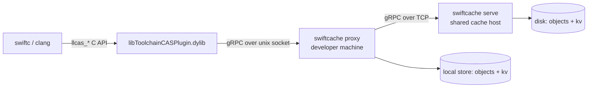

# SwiftCache

**English** · [繁體中文](README.zh-TW.md)

A **remote compilation cache server for Swift / Clang**, written in Rust, speaking the
LLVM remote caching gRPC protocol that Xcode and SwiftPM already use.

In one sentence: Xcode's bundled `libToolchainCASPlugin.dylib` talks **gRPC over a Unix
socket**; implement the two services it expects (`CASDBService` and `KeyValueDB`) and
`swiftc` / `clang` outputs become reusable across machines.

## What is in this repo

| Path | Contents |
| --- | --- |
| `docs/` | Documentation in Chinese (concepts, protocol, Xcode/SwiftPM setup, debugging) |
| `proto/` | The two `.proto` files, taken verbatim from swiftlang/llvm-project |
| `server/` | Rust CAS/KV cache server, local Proxy, and desktop management daemon |
| `desktop-gpui/` | Native Rust desktop app using GPUI / GPUI Kit; manages the daemon |
| `design/` | SVG mockups the desktop app follows |
| `tools/plugin_probe.c` | Drives the Apple CAS plugin directly — a fast feedback loop while developing the server |
| `patches/` | Local patches needed by the OSS projects used for verification |
| `examples/SwiftPMDemo/` | Small SwiftPM verification project |
| `examples/XcodeDemo/` | Small Xcode verification project |
| `scripts/demo.sh` | One-shot end-to-end check: start server, build twice, assert cache hits |

`make oss` clones IceCubesApp and swift-build into `examples/`; those checkouts are not
tracked by git.

## Documentation

1. [Concepts and architecture](docs/01-原理與架構.md) — CAS, action cache, explicit module build
2. [Protocol](docs/02-協定規格.md) — gRPC interface, plugin API, semantics verified in practice
3. [Xcode setup](docs/03-Xcode-設定.md) — every build setting and how to turn it on
4. [SwiftPM setup](docs/04-SwiftPM-設定.md) — the three options on 6.4 and the real interface on 6.5
5. [Rust server](docs/05-Rust-Server.md) — architecture, on-disk format, logging, deployment topologies
6. [Verification and debugging](docs/06-驗證與除錯.md) — probe tool, measurements, common failures

## Quick start

This project uses [huacnlee/cargo](https://huacnlee.github.io/cargo/) **v0.102.0-9**.
`make` selects it automatically; use `./scripts/bin/cargo` for direct Cargo commands.
The first invocation downloads the pinned release with the official checksum-verifying
installer into `.tools/cargo/`, which is ignored by git. Automatic updates are disabled;
the system Cargo stays unchanged. This launcher supports macOS and Linux and requires
`curl`, `tar`, and a SHA-256 utility, plus an installed Rust compiler.
The fork shares intermediate artifacts under `~/.cargo/targets/`, while final binaries
remain under each crate's `target/`. It ignores `CARGO_TARGET_DIR` and `--target-dir`.

```bash
# 1. Build the server (requires protoc)
./scripts/bin/cargo build --release --manifest-path server/Cargo.toml

# 2. Run it (single machine: the compiler connects to the unix socket directly)
./server/target/release/swiftcache serve \
    --store /tmp/swiftcache-store \
    --socket /tmp/swiftcache/cache.sock

# 3. Point a build at it
xcodebuild -project examples/XcodeDemo/DemoTool.xcodeproj -scheme DemoTool \
    COMPILATION_CACHE_ENABLE_CACHING=YES \
    COMPILATION_CACHE_ENABLE_PLUGIN=YES \
    COMPILATION_CACHE_REMOTE_SERVICE_PATH=/tmp/swiftcache/cache.sock \
    COMPILATION_CACHE_ENABLE_DIAGNOSTIC_REMARKS=YES \
    build
```

Or use the Makefile to verify against real projects
([IceCubesApp](https://github.com/Dimillian/IceCubesApp),
[swift-build](https://github.com/swiftlang/swift-build)):

```bash
make server             # terminal 1: serve --socket cache/cache.sock
make oss                # clone both projects into examples/
make icecubes           # IceCubesApp: clone + xcconfig + SDK patch + resolve
make spm-verify         # swift build --build-system native, twice
make pkg-verify         # xcodebuild building a bare Package.swift, twice
make xcode-verify       # xcodebuild (StatusKit scheme), twice
make swiftbuild-verify  # default swiftbuild engine (needs a Swift 6.5-dev snapshot)
make run                # install IceCubesApp into the simulator and launch it
make status             # socket and store state
make toolchain          # snapshot path, bundle id, how to switch
```

Every `*-verify` target prints the hit count and wall time, e.g.
`Cache hit: 1096 筆，耗時 26.1s`.

## Going actually remote

The toolchain plugin only accepts a **unix socket path**, so crossing machines needs a
local hop:



```bash
# cache host
swiftcache serve --store /var/lib/swiftcache --tcp 0.0.0.0:50051

# every developer machine / CI runner
swiftcache proxy --store /var/tmp/swiftcache-proxy --socket /tmp/swiftcache/cache.sock --upstream http://cache-host:50051
```

Proxy requires its own `--store` (or `SWIFTCACHE_STORE`). Reads use the local CAS/KV cache
first and fill it from successful upstream responses on a miss. Writes are acknowledged
only after the upstream and local cache both succeed. A warm Proxy can restart and serve
local hits while the upstream is unavailable; misses and writes surface upstream errors.

The protocol has no TLS and no authentication — put it behind an mTLS reverse proxy or a
VPN before exposing it.

## Logging

Every upload and download is one line, tagged with the caller (peer pid over a unix
socket, remote address over TCP):

```
INFO pid:59234 up   cas save 53208ccb26a7… 4.0 KiB
INFO pid:59387 down kv  get  deadbeef0102… hit entries=1
```

Statistics are reported per build — a burst of RPCs followed by two seconds of silence —
and every report is a delta, never a running total:

```
INFO session #1 done in 31.5s | kv: 0 hit / 1096 miss / 1764 put | cas: 0 hit / 0 miss / 4498 put | 692.6 MiB up, 0 B down | 1 clients: pid:62257
```

Use `SWIFTCACHE_LOG=swiftcache=warn` to silence the per-request lines.

## Desktop app

`desktop-gpui/` is the native desktop app, built with GPUI Kit 0.9.0. It talks to
`swiftcache daemon`, a separate local process that owns the cache services, saved
connections, and history. Closing the window never stops caching; the CLI also works
independently. Desktop preferences are saved in `desktop.json` next to the daemon's data.

Use Rust 1.92 or later. The commands below build the server as well. App and menu-bar
icons, including SVG sources and the PNG/ICNS files used at runtime, are checked in
under `desktop-gpui/assets/`. The `.app` packaging command requires macOS:

```bash
make gpui                         # run the native desktop app
make gpui-app                     # build and open the macOS .app
make gpui-app GPUI_PROFILE=release # optimized macOS .app
```

Both commands launch `SwiftCache.app`, whose Dock display name is **SwiftCache**.

The bundle includes its own `swiftcache` executable. For an isolated data directory, run
`SWIFTCACHE_DATA_DIR=/tmp/swiftcache-gpui make gpui`. Development also accepts
`SWIFTCACHE_BIN` to select a server binary. Quitting the app keeps the daemon and its
services running.

New GPUI connections default to `Server-<UUID8>` or `Proxy-<UUID8>`, where `UUID8` is the
first eight hexadecimal characters of one UUID. The same suffix sets the editable
store `/tmp/<UUID8>` and socket `/tmp/<UUID8>.sock`. Changing the draft's role updates
the generated name prefix and preserves custom names and paths.

* **Connections** — the sidebar lists services, each a serve or proxy config (TCP, unix
  socket, store, blob dir, message limit, log level) with its own start/stop; any number can
  run at once. `+` opens one creation page to choose Server or Proxy and enter its settings;
  the type is fixed after saving. Saved connections show the normal tabs and a read-only
  type label. Create a separate connection to use the other type. The header groups Delete
  connection, Save settings and Start/Stop; Delete asks before removing a stopped connection.
  Set an optional connection name in Configuration; leaving it blank uses the TCP address,
  socket or upstream as its default. Custom names appear in the sidebar, header and menu bar,
  survive restarts, and do not need to be unique. Existing unnamed settings keep working.
  Switching connections with edited settings offers Save, Discard or Cancel. Deleting a
  connection keeps its disk cache and history.
  Starting is refused while another running service already uses the same TCP address, unix
  socket, local store or blob dir. Everything to the right belongs to the selected service:
  a header with state, listener, store/upstream and store usage, then tabs:
  * **Configuration** — connection and storage first; message limits, logs, file responses
    and local cleanup paths are under Advanced settings. Save feedback, Revert changes and
    `⌘S` / `Ctrl+S` keep changes explicit. The shortcuts save the selected connection from
    any main tab, except while a dialog is open, an operation is in progress, or the draft
    cannot be saved. Both Server and Proxy require a primary cache directory (`--store`).
    Successful save/start/stop/delete actions show a small toast sliding in at the bottom
    right; it fades after about four seconds or can be dismissed. It does not move the page.
    Errors remain inline until resolved or dismissed. Reduced-motion preferences are respected.
    New Server and Proxy connections prefill an editable store under `/tmp`, unique to each draft;
    use a persistent location if the cache should survive temporary-file cleanup. TCP uses
    Local only (`127.0.0.1`) / All interfaces (`0.0.0.0`) radio choices plus a separate port
    (default `50051`). Existing custom IP/IPv6 addresses are preserved. On Unix, both desktop
    roles require a local socket path, prefilled under `/tmp`, with no enable checkbox.
    Server also listens on TCP; Proxy uses TCP to connect upstream. Existing socket-only
    Servers are preserved. An existing TCP-only Server needs a socket path before it can be
    saved or started from the desktop for local toolchain use.
    Proxy upstream uses Local only (`127.0.0.1`) / Custom IP or hostname choices and a separate
    port (new connections default to `50051`). The CLI URL is assembled automatically; existing
    schemes, IPv6 addresses and URL paths are preserved. Saved paths keep aliases such as `/tmp`
    in the form and CLI; resource conflicts and clear checks still compare canonical paths.
  * **Transfers** — that service's RPCs with full IDs, timing, request/response, references,
    KV entries and raw payload bytes (hex / text, export), plus its traffic and KV hit rate.
    Paging into history freezes the displayed list's ID boundary and time range, so incoming
    traffic cannot shift later pages. Manual pause keeps that boundary while filtering;
    “Back to latest & resume” returns to live updates. Frozen exports use the same boundary.
    Lists scroll within the page with fixed headers and show details only after selection;
    use Up/Down then Enter/Space to select a row, and Escape in details to close them.
    Detail sizes include both units and exact bytes, e.g. `62.5 KiB (63,980 bytes)`.
    **Clear transfers** deletes this connection's entire transfer history and resets its
    traffic, errors and KV hit-rate statistics. Events remain, with deleted-transfer links removed.
  * **Events** — that service's lifecycle, per-RPC events, log lines and cleanups, linked back
    to transfers. **Clear events** deletes only this connection's events; transfers and their
    statistics remain. Both history actions ask for confirmation and apply regardless of filters.
    The service keeps running and new records can appear. Saved payloads, actual compilation
    cache and settings are retained; clearing history does not reclaim saved payload storage.
  * **Cache** — on-disk usage of its store and manual clear with the exact paths confirmed
    first (refused while any path to delete overlaps the store, blob dir or socket of another
    running service). History lives outside the store and survives a clear. While clearing,
    service actions and connection switching are locked. A stale plan reloads the current
    paths before offering Retry clear; results stay with the service that was cleared.
    Proxy clearing affects its local store only; the upstream cache is retained.
* **macOS menu bar** — size of the running local stores next to the icon; the menu shows
  how many services run, usage, traffic, KV hit rate and errors, plus one submenu per service
  to start/stop it. Closing the window only hides it.
* **Settings** — `⌘,` (app menu or menu bar item), `Ctrl+,` elsewhere: appearance
  (system / light / dark), language (system / 繁體中文 / English, also relabels the menu bar)
  and whether the menu bar shows cache usage next to the icon. Changes apply immediately;
  close with `×` or `Esc`. Stored in `desktop.json` in the app data directory. Messages
  produced by the daemon stay in their original language.

History goes to the app data directory (`~/Library/Application Support/dev.yume.SwiftCache`
on macOS); `swiftcache serve --records <dir>` records CLI runs the same way. On Windows only
TCP `serve` is available, because unix sockets and `proxy` are Unix-only.

## Tests and CI

```bash
./scripts/bin/cargo test --manifest-path server/Cargo.toml        # store, proxy, journal, management
./scripts/bin/cargo test --manifest-path desktop-gpui/Cargo.toml  # API routes, connection editor, defaults
scripts/demo.sh                                                   # end-to-end: probe, Xcode, SwiftPM, proxy
```

GitHub Actions (`.github/workflows/ci.yml`) runs on every pull request and on pushes to
`main`: server tests on Linux and macOS, desktop-gpui tests plus a `SwiftCache.app` bundle
check on macOS, and `scripts/demo.sh` on the `xcode-27` runner (SwiftPM caching needs
Swift 6.4+). CI uses the runner's stock Cargo; `scripts/demo.sh` honours `CARGO` for that.

## Verified on

macOS 27.0 / Xcode 27.0 (Swift 6.4), plus a Swift 6.5-dev snapshot:

* Xcode: after wiping DerivedData and the local CAS, all 6 compile jobs are `Cache hit`
* IceCubesApp, `StatusKit` scheme: 1096 compile jobs, all hits on the second run,
  59.0s → 23.8s, 692.6 MiB up / 435.4 MiB down on the server
* `swiftlang/swift-build`, the same package through three build paths — 100% hits each time:

  | Build path | 1st run | 2nd run | clients seen by server |
  | --- | ---: | ---: | ---: |
  | `xcodebuild` (6.4) | 54.8s | **21.5s** | 1 |
  | `swift build`, default swiftbuild engine (6.5-dev) | 62.2s | **24.4s** | 1 |
  | `swift build --build-system native` (6.4) | 55.8s | **179.7s** | 566 |

  Same hit rate, same bytes downloaded. The difference is that swift-driver forks one
  process per job — the payoff of a remote cache depends on how the build system runs the
  compiler, not on the hit rate.
* The TCP topology through `swiftcache proxy` is verified as well

Details and raw logs: [docs/06-驗證與除錯.md](docs/06-驗證與除錯.md).
