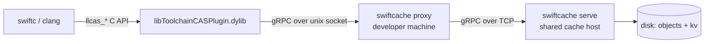

# SwiftCache

**English** · [繁體中文](README.zh-TW.md)

A **remote compilation cache server for Swift / Clang**, written in Rust, speaking the
LLVM remote caching gRPC protocol that Xcode and SwiftPM already use.

In one sentence: Xcode's bundled `libToolchainCASPlugin.dylib` talks **gRPC over a Unix
socket**; implement the two services it expects (`CASDBService` and `KeyValueDB`) and
`swiftc` / `clang` outputs become reusable across machines.

## What is in this repo

| Path | Contents |
| --- | --- |
| `docs/` | Documentation in Chinese (concepts, protocol, Xcode/SwiftPM setup, debugging) |
| `proto/` | The two `.proto` files, taken verbatim from swiftlang/llvm-project |
| `server/` | The Rust server (`swiftcache serve` / `swiftcache proxy`) |
| `tools/plugin_probe.c` | Drives the Apple CAS plugin directly — a fast feedback loop while developing the server |
| `patches/` | Local patches needed by the OSS projects used for verification |
| `examples/SwiftPMDemo/` | Small SwiftPM verification project |
| `examples/XcodeDemo/` | Small Xcode verification project |
| `scripts/demo.sh` | One-shot end-to-end check: start server, build twice, assert cache hits |

`make oss` clones IceCubesApp and swift-build into `examples/`; those checkouts are not
tracked by git.

## Documentation

1. [Concepts and architecture](docs/01-原理與架構.md) — CAS, action cache, explicit module build
2. [Protocol](docs/02-協定規格.md) — gRPC interface, plugin API, semantics verified in practice
3. [Xcode setup](docs/03-Xcode-設定.md) — every build setting and how to turn it on
4. [SwiftPM setup](docs/04-SwiftPM-設定.md) — the three options on 6.4 and the real interface on 6.5
5. [Rust server](docs/05-Rust-Server.md) — architecture, on-disk format, logging, deployment topologies
6. [Verification and debugging](docs/06-驗證與除錯.md) — probe tool, measurements, common failures

## Quick start

```bash
# 1. Build the server (requires protoc)
cargo build --release --manifest-path server/Cargo.toml

# 2. Run it (single machine: the compiler connects to the unix socket directly)
./server/target/release/swiftcache serve \
    --store /tmp/swiftcache-store \
    --socket /tmp/swiftcache/cache.sock

# 3. Point a build at it
xcodebuild -project examples/XcodeDemo/DemoTool.xcodeproj -scheme DemoTool \
    COMPILATION_CACHE_ENABLE_CACHING=YES \
    COMPILATION_CACHE_ENABLE_PLUGIN=YES \
    COMPILATION_CACHE_REMOTE_SERVICE_PATH=/tmp/swiftcache/cache.sock \
    COMPILATION_CACHE_ENABLE_DIAGNOSTIC_REMARKS=YES \
    build
```

Or use the Makefile to verify against real projects
([IceCubesApp](https://github.com/Dimillian/IceCubesApp),
[swift-build](https://github.com/swiftlang/swift-build)):

```bash
make server             # terminal 1: serve --socket cache/cache.sock
make oss                # clone both projects into examples/
make icecubes           # IceCubesApp: clone + xcconfig + SDK patch + resolve
make spm-verify         # swift build --build-system native, twice
make pkg-verify         # xcodebuild building a bare Package.swift, twice
make xcode-verify       # xcodebuild (StatusKit scheme), twice
make swiftbuild-verify  # default swiftbuild engine (needs a Swift 6.5-dev snapshot)
make run                # install IceCubesApp into the simulator and launch it
make status             # socket and store state
make toolchain          # snapshot path, bundle id, how to switch
```

Every `*-verify` target prints the hit count and wall time, e.g.
`Cache hit: 1096 筆，耗時 26.1s`.

## Going actually remote

The toolchain plugin only accepts a **unix socket path**, so crossing machines needs a
local hop:



```bash
# cache host
swiftcache serve --store /var/lib/swiftcache --tcp 0.0.0.0:50051

# every developer machine / CI runner
swiftcache proxy --socket /tmp/swiftcache/cache.sock --upstream http://cache-host:50051
```

The protocol has no TLS and no authentication — put it behind an mTLS reverse proxy or a
VPN before exposing it.

## Logging

Every upload and download is one line, tagged with the caller (peer pid over a unix
socket, remote address over TCP):

```
INFO pid:59234 up   cas save 53208ccb26a7… 4.0 KiB
INFO pid:59387 down kv  get  deadbeef0102… hit entries=1
```

Statistics are reported per build — a burst of RPCs followed by two seconds of silence —
and every report is a delta, never a running total:

```
INFO session #1 done in 31.5s | kv: 0 hit / 1096 miss / 1764 put | cas: 0 hit / 0 miss / 4498 put | 692.6 MiB up, 0 B down | 1 clients: pid:62257
```

Use `SWIFTCACHE_LOG=swiftcache=warn` to silence the per-request lines.

## Verified on

macOS 27.0 / Xcode 27.0 (Swift 6.4), plus a Swift 6.5-dev snapshot:

* Xcode: after wiping DerivedData and the local CAS, all 6 compile jobs are `Cache hit`
* IceCubesApp, `StatusKit` scheme: 1096 compile jobs, all hits on the second run,
  59.0s → 23.8s, 692.6 MiB up / 435.4 MiB down on the server
* `swiftlang/swift-build`, the same package through three build paths — 100% hits each time:

  | Build path | 1st run | 2nd run | clients seen by server |
  | --- | ---: | ---: | ---: |
  | `xcodebuild` (6.4) | 54.8s | **21.5s** | 1 |
  | `swift build`, default swiftbuild engine (6.5-dev) | 62.2s | **24.4s** | 1 |
  | `swift build --build-system native` (6.4) | 55.8s | **179.7s** | 566 |

  Same hit rate, same bytes downloaded. The difference is that swift-driver forks one
  process per job — the payoff of a remote cache depends on how the build system runs the
  compiler, not on the hit rate.
* The TCP topology through `swiftcache proxy` is verified as well

Details and raw logs: [docs/06-驗證與除錯.md](docs/06-驗證與除錯.md).
