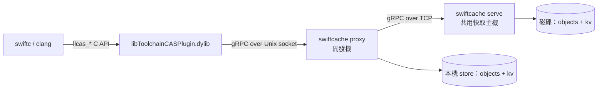

# SwiftCache

[English](README.md) · **繁體中文**

用 Rust 實作的 **Swift / Clang 編譯快取伺服器**（remote compilation cache），
相容 Xcode 與 SwiftPM 所使用的 LLVM remote caching gRPC 協定。

一句話說明運作方式：Xcode 內建的 `libToolchainCASPlugin.dylib` 會透過 **Unix socket
上的 gRPC** 連到快取伺服器，伺服器只要實作兩個 service（`CASDBService` 與
`KeyValueDB`）就能讓 `swiftc` / `clang` 的編譯結果跨機器重用。

## 這個 repo 有什麼

| 路徑 | 內容 |
| --- | --- |
| `docs/` | 中文文件（原理、協定、Xcode/SwiftPM 設定、除錯） |
| `proto/` | 從 swiftlang/llvm-project 原樣取得的兩份 `.proto` |
| `server/` | Rust CAS/KV 快取伺服器、本機 Proxy 與桌面管理 daemon |
| `desktop-gpui/` | 使用 GPUI／GPUI Kit 的 Rust 原生桌面程式，負責管理 daemon |
| `design/` | 桌面程式依循的 SVG 設計稿 |
| `tools/plugin_probe.c` | 直接驅動 Apple CAS plugin 的探針，開發伺服器時的快速回饋迴圈 |
| `patches/` | 驗證用 OSS 專案需要的本機 patch |
| `examples/SwiftPMDemo/` | SwiftPM 驗證專案 |
| `examples/XcodeDemo/` | Xcode 驗證專案 |
| `scripts/demo.sh` | 一鍵端到端驗證：起 server、兩次建置、檢查 cache hit |

`make oss` 會把 IceCubesApp 與 swift-build clone 到 `examples/`，這兩份不進版控。

## 文件導覽

1. [原理與架構](docs/01-原理與架構.md) — CAS、action cache、explicit module build 是什麼
2. [協定規格](docs/02-協定規格.md) — gRPC 介面、plugin API、實測出來的語意
3. [Xcode 設定](docs/03-Xcode-設定.md) — build settings 一覽與啟用步驟
4. [SwiftPM 設定](docs/04-SwiftPM-設定.md) — 6.4 的三條路與 6.5 的正式介面
5. [Rust Server 實作](docs/05-Rust-Server.md) — 架構、儲存格式、紀錄與部署拓撲
6. [驗證與除錯](docs/06-驗證與除錯.md) — 探針工具、實測記錄、常見錯誤

## 快速開始

本專案使用 [huacnlee/cargo](https://huacnlee.github.io/cargo/) **v0.102.0-9**。
`make` 會自動選用；直接執行 Cargo 指令時請用 `./scripts/bin/cargo`。
第一次執行會透過官方 installer 下載固定版本並驗證 checksum，安裝至不進版控的
`.tools/cargo/`。已停用自動更新，系統 Cargo 保持原樣。此 launcher 支援 macOS／Linux，
需要 `curl`、`tar`、SHA-256 工具及已安裝的 Rust 編譯器。
中間產物共用於 `~/.cargo/targets/`，最終執行檔仍在各 crate 的 `target/` 下；
這個 fork 會忽略 `CARGO_TARGET_DIR` 與 `--target-dir`。

```bash
# 1. 編譯伺服器（需要 protoc）
./scripts/bin/cargo build --release --manifest-path server/Cargo.toml

# 2. 啟動（單機：編譯器直接連 Unix socket）
./server/target/release/swiftcache serve \
    --store /tmp/swiftcache-store \
    --socket /tmp/swiftcache/cache.sock

# 3. 用 Xcode 建置並指向它
xcodebuild -project examples/XcodeDemo/DemoTool.xcodeproj -scheme DemoTool \
    COMPILATION_CACHE_ENABLE_CACHING=YES \
    COMPILATION_CACHE_ENABLE_PLUGIN=YES \
    COMPILATION_CACHE_REMOTE_SERVICE_PATH=/tmp/swiftcache/cache.sock \
    COMPILATION_CACHE_ENABLE_DIAGNOSTIC_REMARKS=YES \
    build
```

或用 Makefile 直接拿真實專案（[IceCubesApp](https://github.com/Dimillian/IceCubesApp)、
[swift-build](https://github.com/swiftlang/swift-build)）驗證：

```bash
make server             # terminal 1：serve --socket cache/cache.sock
make oss                # clone 到 examples/（IceCubesApp、swift-build）
make spm-verify         # swift build --build-system native 跑兩次
make pkg-verify         # xcodebuild 直接建 SwiftPM 套件，跑兩次
make xcode-verify       # xcodebuild（StatusKit scheme）跑兩次
make swiftbuild-verify  # 預設 swiftbuild 引擎（需要 Swift 6.5-dev snapshot）
make run                # 把 IceCubesApp 裝進模擬器跑起來
make status             # socket 與 store 現況
make toolchain          # 6.5-dev snapshot 路徑、bundle id 與切換方式
```

每個 verify 都會印命中筆數與牆鐘時間，例如 `Cache hit: 1096 筆，耗時 26.1s`。

## 真正「遠端」的拓樸

toolchain plugin 只接受 **Unix socket 路徑**，所以跨機器時需要本機中繼：



```bash
# 快取主機
swiftcache serve --store /var/lib/swiftcache --tcp 0.0.0.0:50051

# 每台開發機
swiftcache proxy --store /var/tmp/swiftcache-proxy --socket /tmp/swiftcache/cache.sock --upstream http://cache-host:50051
```

Proxy 必填本機 `--store`（或 `SWIFTCACHE_STORE`）。讀取先查本機 CAS／KV，未命中時從
上游取得並保存成功結果；寫入須等上游與本機都成功才回覆。已有快取的 Proxy 可在上游
離線時重新啟動並提供本機命中；未命中與寫入會回報上游錯誤。

## 紀錄

每一筆上傳／下載都有一行，並帶呼叫端身分（unix socket 取對端 pid、TCP 取位址）：

```
INFO pid:59234 up   cas save 53208ccb26a7… 4.0 KiB
INFO pid:59387 down kv  get  deadbeef0102… hit entries=1
```

統計以「一次建置」為單位（計數器 2 秒沒動算結束），每段只報自己的差值：

```
INFO session #1 done in 31.5s | kv: 0 hit / 1096 miss / 1764 put | cas: 0 hit / 0 miss / 4498 put | 692.6 MiB up, 0 B down | 1 clients: pid:62257
```

量太大時用 `SWIFTCACHE_LOG=swiftcache=warn` 關掉逐筆紀錄。

## 桌面程式

`desktop-gpui/` 是使用 GPUI Kit 0.9.0 的原生桌面程式，連到獨立的本機程序
`swiftcache daemon`，由 daemon 管理快取服務、已儲存連線與歷史紀錄。關閉視窗不會
中斷快取，CLI 也能獨立使用；桌面偏好設定儲存在 daemon 資料目錄旁的 `desktop.json`。

需要 Rust 1.92 以上，下列指令也會建置 server。App 與選單列圖示的 SVG 原始檔，
以及執行時使用的 PNG／ICNS，皆放在 `desktop-gpui/assets/` 並納入版控。
`.app` 打包指令需在 macOS 執行：

```bash
make gpui                         # 執行原生桌面介面
make gpui-app                     # 建置並開啟 macOS .app
make gpui-app GPUI_PROFILE=release # 建置最佳化的 macOS .app
```

兩種執行方式皆使用 `SwiftCache.app`，Dock 顯示名稱為 **SwiftCache**。

`.app` 內含 `swiftcache` 執行檔。若要使用獨立資料目錄，可執行
`SWIFTCACHE_DATA_DIR=/tmp/swiftcache-gpui make gpui`；開發時亦可用
`SWIFTCACHE_BIN` 指定 server。結束程式會保留 daemon 與執行中的服務。

GPUI 新連線預設名稱為 `Server-<UUID8>` 或 `Proxy-<UUID8>`，`UUID8` 是同一個 UUID
的前 8 碼十六進位字元；快取目錄為 `/tmp/<UUID8>`，socket 為 `/tmp/<UUID8>.sock`，
皆可修改。切換草稿類型時會更新預設名稱的前綴，保留自訂名稱與路徑。

* **連線**：側欄是服務清單，每筆是一份 serve 或 proxy 設定（TCP、Unix socket、store、
  blob 目錄、訊息上限、log 層級），各自啟停，可同時執行多個。`+` 開啟單一建立頁，選擇
  Server 或 Proxy 並填寫設定，儲存後類型即固定；已有連線顯示正常分頁與唯讀類型標示，
  要用另一種類型請新增連線。頂部狀態列集中「刪除連線／儲存設定／啟動或停止」。刪除會先
  確認，保留磁碟快取與紀錄。切換連線前
  若有設定變更，可選擇儲存、捨棄或取消。
  「組態」可自訂連線名稱，留空則依 TCP 位址、socket 或 upstream 顯示預設名稱。名稱會儲存，
  並顯示於側欄、狀態標題與選單列；允許重複名稱，舊版未命名的設定仍可正常使用。
  若另一個執行中的服務已使用相同的 TCP 位址、Unix
  socket、本機 store 或 blob 目錄，會拒絕啟動。右側全部屬於選取的服務：上方是狀態、
  監聽位址、store／upstream 與 store 用量，下面分頁：
  * **組態**：先設定連線與儲存；訊息上限、Log、檔案回應與本機清除路徑放在「進階設定」。
    提供儲存結果、還原變更與同等 CLI 指令。`⌘S`／`Ctrl+S` 可在主畫面各分頁儲存目前連線，
    確認視窗開啟、操作進行中或設定無法儲存時不會觸發。Server 與 Proxy 都必填主要快取目錄。
    儲存、啟停與刪除成功時，右下角會滑入提示，約四秒後淡出，也可手動關閉，不會推移版面；
    錯誤訊息仍保留在頁面上。提示動畫會配合系統的「減少動態效果」設定。
    新 Server 與 Proxy 都會在 `/tmp` 下預填可修改的快取目錄，每筆新連線各自獨立；需要長期保留時可
    改用永久目錄。TCP 拆成「僅本機 `127.0.0.1`／所有介面 `0.0.0.0`」radio 與獨立 Port
    欄位（預設 `50051`），既有自訂 IP／IPv6 保留。macOS／Unix 桌面程式的兩種模式都直接
    填寫本機 socket 路徑，預設位於 `/tmp` 下，沒有啟用勾選。Server 另外提供 TCP；
    Proxy 透過 TCP 連上游。既有 socket-only Server 保留原設定；既有 TCP-only Server 需先
    補上 socket 路徑，才能從桌面程式儲存或啟動，供本機工具鏈使用。
    Proxy 上游拆成「僅本機 `127.0.0.1`／自訂 IP 或主機名稱」與獨立 Port，新連線預設
    `127.0.0.1:50051`。CLI 會自動組成網址，既有協定、IPv6 與 URL 路徑保留。設定、畫面與
    CLI 會保留 `/tmp` 等路徑寫法；資源衝突與清除檢查仍以實體路徑比對。
  * **傳輸明細**：該服務逐筆 RPC 的完整 ID、耗時、請求／回應、references、KV entries 與
    原始 payload（Hex／Text、匯出），以及它的流量與 KV 命中率。翻到歷史頁會固定目前清單的
    ID 邊界與時間範圍，新增流量不會推移後續頁面；手動暫停後仍可在同一範圍篩選，按
    「回到最新並繼續」才恢復更新，匯出也沿用相同邊界。清單內捲動、表頭固定，選取後才展開
    詳細資料；可用上下鍵移動、Enter／空白鍵選取，在詳細資料內按 Esc 關閉。
    詳細資料大小同時顯示換算單位與精確 bytes，例如 `62.5 KiB (63,980 bytes)`。
    「清除傳輸明細」刪除目前連線的全部傳輸紀錄，並重設流量、錯誤與 KV 命中率統計；
    事件保留，但移除指向已刪除傳輸的連結。
  * **事件紀錄**：該服務的啟停、每筆 RPC、log 與清除事件，可連回對應傳輸。
    「清除事件紀錄」只刪除目前連線的事件，保留傳輸與統計。兩種紀錄清除都會先確認，
    範圍涵蓋該連線全部紀錄，不受篩選影響。服務持續執行，新紀錄仍可出現；已保存的
    payload、實際編譯快取與設定保留，因此清除紀錄不會回收已保存 payload 的磁碟空間。
  * **快取**：該服務 store 的磁碟用量，先確認完整路徑再手動清除（要刪的路徑與另一個執行中
    服務的 store、blob 目錄或 socket 重疊時拒絕）。清除中鎖住啟停與切換連線；計畫過期時先
    重新載入路徑，再提供重試。清除結果屬於原服務，紀錄存放在 store 之外，清除後保留。
    Proxy 清除只作用於本機 store，上游快取仍保留。
* **macOS 選單列**：圖示旁顯示執行中本機 store 的總大小；選單顯示執行中服務數、用量、
  流量、KV 命中率與錯誤數，每個服務一個子選單可直接啟停。關閉視窗只會隱藏。
* **設定**：`⌘,`（App 選單或選單列項目）、其他平台 `Ctrl+,`。可設定外觀（跟隨系統／
  淺色／深色）、語言（跟隨系統／繁體中文／English，選單列一併切換），以及選單列圖示旁
  是否顯示快取用量。變更立即生效，按 `×` 或 `Esc` 關閉。存在應用程式資料目錄的
  `desktop.json`。daemon 產生的訊息維持原文。

紀錄存放在應用程式資料目錄（macOS 為 `~/Library/Application Support/dev.yume.SwiftCache`）；
`swiftcache serve --records <dir>` 也能用同樣格式記錄 CLI 執行。Windows 上只能用 TCP
`serve`，Unix socket 與 `proxy` 僅支援 Unix 系平台。

## 測試與 CI

```bash
./scripts/bin/cargo test --manifest-path server/Cargo.toml        # store、proxy、journal、management
./scripts/bin/cargo test --manifest-path desktop-gpui/Cargo.toml  # API 路由、連線編輯器、預設值
./scripts/bin/cargo clippy --all-targets --manifest-path server/Cargo.toml -- -D warnings  # desktop-gpui 同理
./scripts/bin/cargo fmt --manifest-path server/Cargo.toml       # rustfmt.toml：max_width = 120
scripts/demo.sh                                                   # 端到端：probe、Xcode、SwiftPM、proxy
```

GitHub Actions（`.github/workflows/ci.yml`）會在每個 PR 及推送到 `main` 時執行：`cargo fmt --check`；
在 Linux 與 macOS 跑 server 測試與 clippy；在 macOS 跑 desktop-gpui 測試、clippy 並檢查
`SwiftCache.app` 打包；另用 `xcode-27` runner 執行 `scripts/demo.sh`（SwiftPM 快取需要 Swift 6.4
以上）。clippy 有任何警告即失敗。CI 使用 runner 的標準 Cargo，`scripts/demo.sh` 可透過 `CARGO`
指定。Dependabot（`.github/dependabot.yml`）每週提出 Actions 與 Cargo 依賴更新。

程式碼曾用 rustfmt 統一格式化一次；`.git-blame-ignore-revs` 記錄該 commit，GitHub 的 blame 會略過它
（本機可執行 `git config blame.ignoreRevsFile .git-blame-ignore-revs`）。

## 驗證狀態

在 macOS 27.0 / Xcode 27.0（Swift 6.4）與 Swift 6.5-dev snapshot 上實測通過：

* Xcode：清空 DerivedData 與本機 CAS 後重建 → 6 個編譯工作全部 `Cache hit`
* 真實專案 IceCubesApp 的 `StatusKit` scheme：1096 個編譯工作第二次全部命中，
  59.0s → 23.8s，server 側 692.6 MiB 上傳 / 435.4 MiB 下載
* 真實套件 `swiftlang/swift-build`：同一套件三條路對照，第二次都 100% 命中

  | 建置方式 | 第 1 次 | 第 2 次 | server 看到的 client 數 |
  | --- | ---: | ---: | ---: |
  | `xcodebuild`（6.4） | 54.8s | **21.5s** | 1 |
  | `swift build` 預設 swiftbuild 引擎（6.5-dev） | 62.2s | **24.4s** | 1 |
  | `swift build --build-system native`（6.4） | 55.8s | **179.7s** | 566 |

  命中率相同、下載量相同，差別在 swift-driver 每個工作一個 process —— 遠端快取的
  效益取決於建置系統怎麼跑編譯器
* 透過 `swiftcache proxy` 的 TCP 遠端拓樸亦驗證通過

細節與原始 log 見 [驗證與除錯](docs/06-驗證與除錯.md)。
