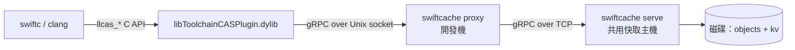

# SwiftCache

[English](README.md) · **繁體中文**

用 Rust 實作的 **Swift / Clang 編譯快取伺服器**（remote compilation cache），
相容 Xcode 與 SwiftPM 所使用的 LLVM remote caching gRPC 協定。

一句話說明運作方式：Xcode 內建的 `libToolchainCASPlugin.dylib` 會透過 **Unix socket
上的 gRPC** 連到快取伺服器，伺服器只要實作兩個 service（`CASDBService` 與
`KeyValueDB`）就能讓 `swiftc` / `clang` 的編譯結果跨機器重用。

## 這個 repo 有什麼

| 路徑 | 內容 |
| --- | --- |
| `docs/` | 中文文件（原理、協定、Xcode/SwiftPM 設定、除錯） |
| `proto/` | 從 swiftlang/llvm-project 原樣取得的兩份 `.proto` |
| `server/` | Rust 伺服器（`swiftcache serve` / `swiftcache proxy`） |
| `tools/plugin_probe.c` | 直接驅動 Apple CAS plugin 的探針，開發伺服器時的快速回饋迴圈 |
| `patches/` | 驗證用 OSS 專案需要的本機 patch |
| `examples/SwiftPMDemo/` | SwiftPM 驗證專案 |
| `examples/XcodeDemo/` | Xcode 驗證專案 |
| `scripts/demo.sh` | 一鍵端到端驗證：起 server、兩次建置、檢查 cache hit |

`make oss` 會把 IceCubesApp 與 swift-build clone 到 `examples/`，這兩份不進版控。

## 文件導覽

1. [原理與架構](docs/01-原理與架構.md) — CAS、action cache、explicit module build 是什麼
2. [協定規格](docs/02-協定規格.md) — gRPC 介面、plugin API、實測出來的語意
3. [Xcode 設定](docs/03-Xcode-設定.md) — build settings 一覽與啟用步驟
4. [SwiftPM 設定](docs/04-SwiftPM-設定.md) — 6.4 的三條路與 6.5 的正式介面
5. [Rust Server 實作](docs/05-Rust-Server.md) — 架構、儲存格式、紀錄與部署拓撲
6. [驗證與除錯](docs/06-驗證與除錯.md) — 探針工具、實測記錄、常見錯誤

## 快速開始

```bash
# 1. 編譯伺服器（需要 protoc）
cargo build --release --manifest-path server/Cargo.toml

# 2. 啟動（單機：編譯器直接連 Unix socket）
./server/target/release/swiftcache serve \
    --store /tmp/swiftcache-store \
    --socket /tmp/swiftcache/cache.sock

# 3. 用 Xcode 建置並指向它
xcodebuild -project examples/XcodeDemo/DemoTool.xcodeproj -scheme DemoTool \
    COMPILATION_CACHE_ENABLE_CACHING=YES \
    COMPILATION_CACHE_ENABLE_PLUGIN=YES \
    COMPILATION_CACHE_REMOTE_SERVICE_PATH=/tmp/swiftcache/cache.sock \
    COMPILATION_CACHE_ENABLE_DIAGNOSTIC_REMARKS=YES \
    build
```

或用 Makefile 直接拿真實專案（[IceCubesApp](https://github.com/Dimillian/IceCubesApp)、
[swift-build](https://github.com/swiftlang/swift-build)）驗證：

```bash
make server             # terminal 1：serve --socket cache/cache.sock
make oss                # clone 到 examples/（IceCubesApp、swift-build）
make spm-verify         # swift build --build-system native 跑兩次
make pkg-verify         # xcodebuild 直接建 SwiftPM 套件，跑兩次
make xcode-verify       # xcodebuild（StatusKit scheme）跑兩次
make swiftbuild-verify  # 預設 swiftbuild 引擎（需要 Swift 6.5-dev snapshot）
make run                # 把 IceCubesApp 裝進模擬器跑起來
make status             # socket 與 store 現況
make toolchain          # 6.5-dev snapshot 路徑、bundle id 與切換方式
```

每個 verify 都會印命中筆數與牆鐘時間，例如 `Cache hit: 1096 筆，耗時 26.1s`。

## 真正「遠端」的拓樸

toolchain plugin 只接受 **Unix socket 路徑**，所以跨機器時需要本機中繼：



```bash
# 快取主機
swiftcache serve --store /var/lib/swiftcache --tcp 0.0.0.0:50051

# 每台開發機
swiftcache proxy --socket /tmp/swiftcache/cache.sock --upstream http://cache-host:50051
```

## 紀錄

每一筆上傳／下載都有一行，並帶呼叫端身分（unix socket 取對端 pid、TCP 取位址）：

```
INFO pid:59234 up   cas save 53208ccb26a7… 4.0 KiB
INFO pid:59387 down kv  get  deadbeef0102… hit entries=1
```

統計以「一次建置」為單位（計數器 2 秒沒動算結束），每段只報自己的差值：

```
INFO session #1 done in 31.5s | kv: 0 hit / 1096 miss / 1764 put | cas: 0 hit / 0 miss / 4498 put | 692.6 MiB up, 0 B down | 1 clients: pid:62257
```

量太大時用 `SWIFTCACHE_LOG=swiftcache=warn` 關掉逐筆紀錄。

## 驗證狀態

在 macOS 27.0 / Xcode 27.0（Swift 6.4）與 Swift 6.5-dev snapshot 上實測通過：

* Xcode：清空 DerivedData 與本機 CAS 後重建 → 6 個編譯工作全部 `Cache hit`
* 真實專案 IceCubesApp 的 `StatusKit` scheme：1096 個編譯工作第二次全部命中，
  59.0s → 23.8s，server 側 692.6 MiB 上傳 / 435.4 MiB 下載
* 真實套件 `swiftlang/swift-build`：同一套件三條路對照，第二次都 100% 命中

  | 建置方式 | 第 1 次 | 第 2 次 | server 看到的 client 數 |
  | --- | ---: | ---: | ---: |
  | `xcodebuild`（6.4） | 54.8s | **21.5s** | 1 |
  | `swift build` 預設 swiftbuild 引擎（6.5-dev） | 62.2s | **24.4s** | 1 |
  | `swift build --build-system native`（6.4） | 55.8s | **179.7s** | 566 |

  命中率相同、下載量相同，差別在 swift-driver 每個工作一個 process —— 遠端快取的
  效益取決於建置系統怎麼跑編譯器
* 透過 `swiftcache proxy` 的 TCP 遠端拓樸亦驗證通過

細節與原始 log 見 [驗證與除錯](docs/06-驗證與除錯.md)。
