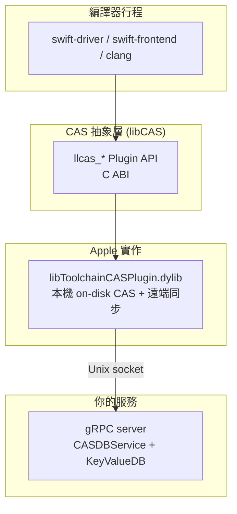

# 01 — 原理與架構

## 1. 問題：Swift 的編譯快取為什麼需要一台 server

傳統的 `ccache` 靠「把命令列 + 前處理後的原始碼做雜湊」來比對，對 Swift 不管用：
Swift 編譯一個檔案時會讀入整個 module 的介面、`.swiftmodule`、Clang module（PCM）、
SDK 內容，輸入集合不是一條命令列能描述的。

Apple 的解法是把「輸入集合」本身變成內容定址的物件圖：

* **CAS**（Content Addressable Storage）— 存 immutable 的 object，每個 object =
  `data`（位元組）+ `refs`（指向其他 object 的參照清單）。id 由內容決定。
* **Action cache / KeyValue DB** — 一張 `cache key -> 結果 object id` 的表。
  cache key 是「這次編譯動作的完整輸入」的雜湊。

編譯一個檔案的流程變成：

1. **掃描依賴**（dependency scanning）：算出這次 frontend job 真正會讀到的所有檔案
   與 module，產生一個 CAS 檔案系統快照。
2. **算 cache key**：把 frontend 的參數 + 上述快照雜湊成一個 key。
3. **查 action cache**：命中就直接把輸出（`.o`、`.swiftmodule`、diagnostics…）
   從 CAS 取回「重播」(replay)，完全不執行 frontend。
4. 沒命中才真的跑 frontend，再把輸出寫回 CAS 與 action cache。

因為 key 由內容決定、輸出也存在 CAS，這份快取可以安全地跨機器共用 —— 這就是
remote cache server 的位置。

## 2. 前置條件：Explicit Module Build

步驟 1 的「掃描依賴」只有在 **explicit module build** 下才存在。隱式 module build
時 Clang/Swift 會在編譯中途自己去 build module、寫 module cache，輸入集合無法事先決定。

所以：

* Xcode：`SWIFT_ENABLE_COMPILE_CACHE` / `CLANG_ENABLE_COMPILE_CACHE` 會自動帶出
  explicit modules（Xcode 16 之後 explicit modules 已是預設）。
* 命令列：必須自己加 `-explicit-module-build`，否則 swift-driver 會丟出
  `warning: -cache-compile-job cannot be used without explicit module build, turn off caching`。

## 3. 元件分工

三層的責任界線很重要：

| 層 | 誰實作 | 負責什麼 |
| --- | --- | --- |
| 編譯器 | Apple | 算 cache key、掃描依賴、replay 輸出 |
| CAS plugin | Apple（`libToolchainCASPlugin.dylib`） | 本機 on-disk CAS、digest 計算、決定什麼時候上傳／下載 |
| 遠端服務 | **你** | 單純的 blob 儲存 + key/value 儲存 |

**你不需要實作任何雜湊或 Swift 語意**。plugin 用自己的 digest（實測為
`luxon.blake2b`，65 bytes）；對 server 來說 CAS id 是不透明位元組，你只要保證
「`Save` 回傳什麼 id，之後 `Load` 用那個 id 要拿得回同樣的 bytes」。

## 4. 本機 CAS 與遠端快取的關係

plugin 永遠會在 `--ondisk-path`（Xcode 設定為 `COMPILATION_CACHE_CAS_PATH/plugin`）
維護一份本機 CAS。遠端服務是它的上游：

* 本機命中 → 不碰網路（log 會出現 `local cache miss` 時才往上走）。
* 本機沒有、遠端有 → 下載並重播，這就是「冷機器也能秒建」的來源。
* 兩邊都沒有 → 真的編譯，結果同時寫本機與遠端。

Xcode 的診斷訊息對應關係：

| 訊息 | 意義 |
| --- | --- |
| `Local cache miss for key: 0~…` | 本機 action cache 沒有這個 key，接著會問遠端 |
| `Replay cache miss` | 最終（含遠端）沒命中，要真的編譯 |
| `Replay cache hit` / `Cache hit` | 命中並成功重播輸出 |

## 5. 一次編譯在協定上長什麼樣

以一個 Swift 檔案的 frontend job 為例，server 會依序看到：

1. `KeyValueDB.GetValue(key)` — 查 action cache。miss 就結束。
2. 編譯完成後 `CASDBService.Save(blob)`（大輸出，如 `.o`、`.swiftmodule`），
   每個 blob 一次，server 回傳 id。
3. `KeyValueDB.PutValue(key, value)` — value 是一張 `map<string, bytes>`，
   裡面包著結果物件圖；夠小的節點會**直接內嵌**，大的節點則放上一步拿到的 CAS id。
4. 下次命中時：`GetValue(key)` 回傳該 value，plugin 解析後對需要的大 blob 呼叫
   `CASDBService.Load(id)`。

實測 log（小專案，輸出都很小）常常只會看到 `GetValue` / `PutValue`，完全不碰
`CASDBService` —— 因為整張物件圖都被內嵌進 value 了。這是正常的。
